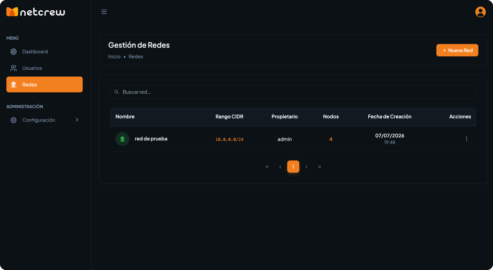
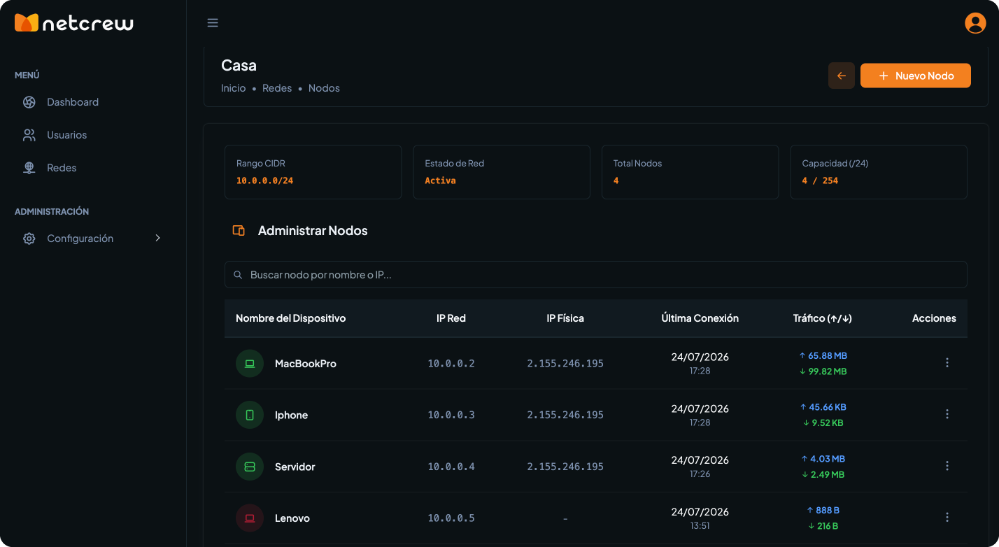
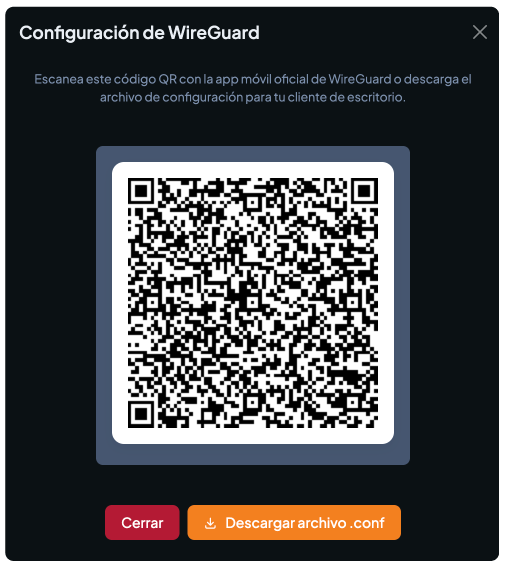
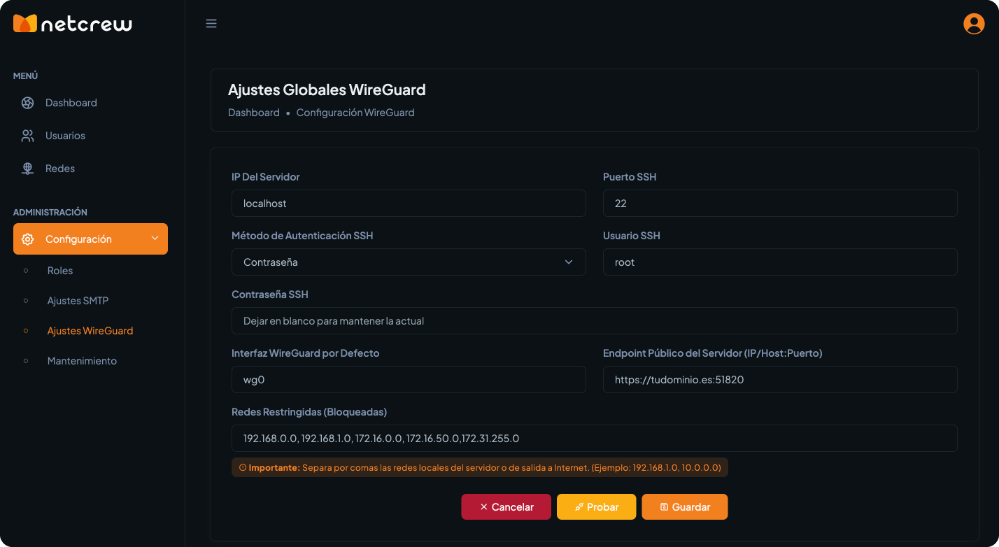
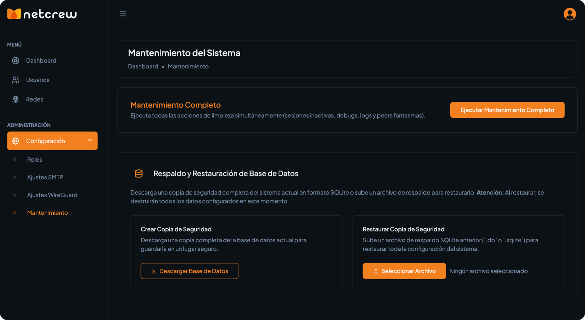
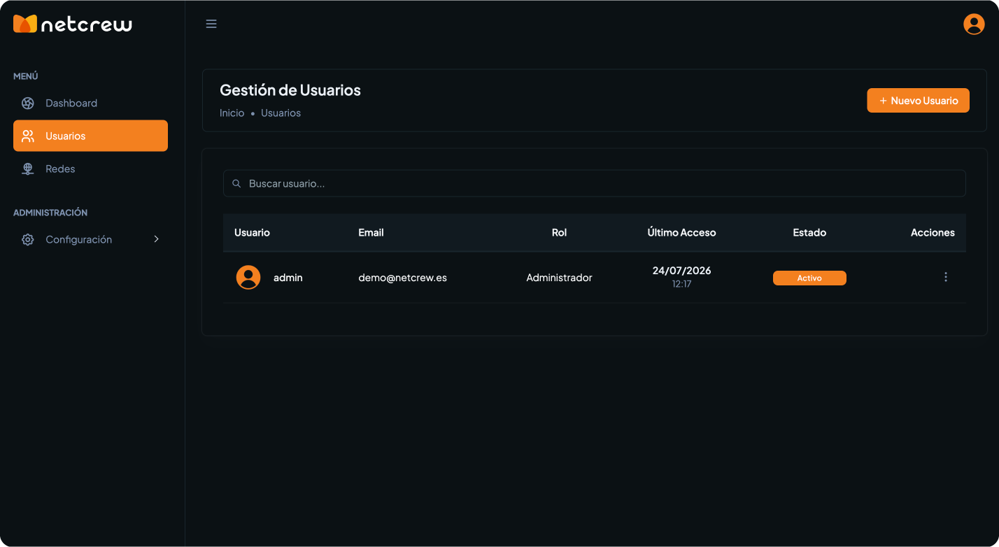
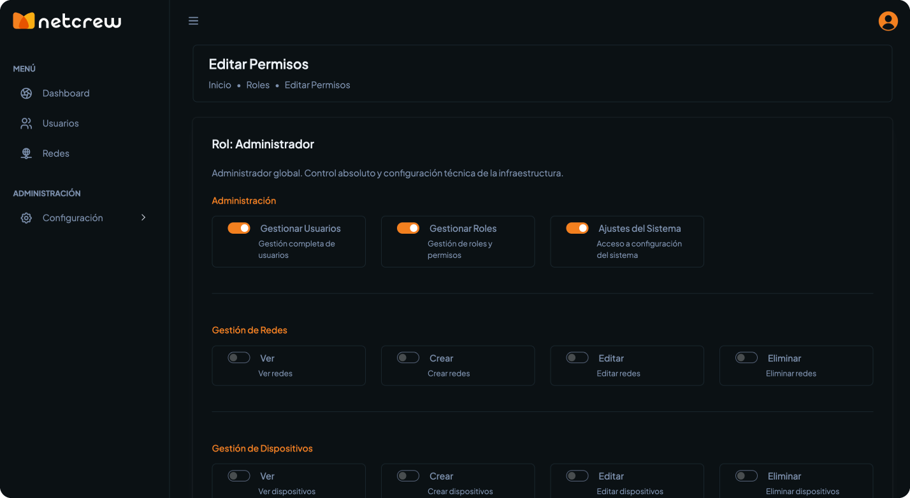

# 🚀 NetCrew - Centralized WireGuard VPN Manager

<p align="center">
  
  <br>
  <b>Plataforma Open Source de Administración Centralizada para Redes VPN basadas en WireGuard.</b>
  <br><br>
  <a href="https://github.com/fredeabal/netcrew/releases"></a>
  <a href="https://www.php.net/"></a>
  <a href="https://codeigniter.com/"></a>
  <a href="https://www.wireguard.com/"></a>
  <a href="LICENSE"></a>
</p>

---

## 🚀 Instalación en 1 Paso

En cualquier servidor **Debian 11/12** o **Ubuntu 20.04 / 22.04 / 24.04** limpio con acceso root (VPS o máquina virtual), ejecuta el siguiente comando en tu terminal:

```bash
bash <(curl -s https://raw.githubusercontent.com/fredeabal/netcrew/main/install.sh)
```

El script se encargará automáticamente de todo el proceso de instalación y configuración del servidor.

### 🔑 Credenciales por Defecto tras la Instalación
* **URL:** `http://TU_IP_O_DOMINIO`
* **Email:** `admin@demo.com`
* **Password:** `admin1234`

### ⚙️ Configuración Post-Instalación Recomendada

Para el correcto funcionamiento de todas las características de NetCrew, es necesario configurar dos componentes clave en el panel de administración:

#### 1. 🔑 Acceso SSH y Sincronización WireGuard
NetCrew utiliza SSH para comunicarse con el servidor WireGuard y aplicar las configuraciones en tiempo real.
* **Mismo Servidor (Despliegue Local):** Si ejecutas NetCrew en el mismo servidor donde se encuentra WireGuard, **no requiere ninguna configuración adicional** (el sistema queda vinculado automáticamente tras la instalación).
* **Servidor Remoto o Instalación Manual:** Si el motor de WireGuard se encuentra en una máquina o servidor diferente:
  1. Dirígete a **Ajustes WireGuard** en la barra lateral del panel.
  2. Introduce los datos de acceso SSH de la máquina remota (**Host SSH**, **Puerto**, **Usuario** con permisos de administración y su **Clave Privada** o contraseña).

#### 2. 📧 Configuración de Correo (SMTP)
NetCrew utiliza el servicio de correo para la recuperación de contraseñas de usuarios y otras notificaciones del sistema.
1. Ve a **Ajustes SMTP** en la barra lateral.
2. Introduce los datos de tu servidor de correo (Host, Puerto, Usuario, Contraseña y tipo de encriptación TLS/SSL).
3. Utiliza la opción **Enviar Correo de Prueba** para verificar que la configuración sea correcta.

---

## 🔄 Actualizar a la última versión

Para actualizar un servidor NetCrew existente a la última versión disponible (sin perder tus configuraciones, redes o bases de datos), simplemente ejecuta:

```bash
bash <(curl -s https://raw.githubusercontent.com/fredeabal/netcrew/main/update.sh)
```

---

## 💡 ¿Qué es NetCrew?

**NetCrew** es un potente **Control Plane** (panel de administración centralizado) autohospedado para redes VPN **WireGuard**. Permite coordinar topologías de red **Hub-and-Spoke**, generar automáticamente archivos de configuración `.conf` y códigos QR para clientes, gestionar dispositivos en tiempo real vía SSH y proteger los accesos mediante un sistema robusto de permisos y roles (RBAC).

El servidor NetCrew interconecta dispositivos ubicados detrás de cualquier NAT o cortafuegos sin necesidad de abrir puertos en las máquinas cliente ni realizar configuraciones manuales complejas.

---

## ✨ Características Principales

### 🌐 Gestión de Redes y Nodos
* **Arquitectura Hub-and-Spoke:** Los nodos se conectan centralizadamente al servidor WireGuard, permitiendo la interconexión transparente entre ellos.
* **Split-Tunnel vs Full-Tunnel:** Opción configurable por nodo para enrutar únicamente el tráfico de la red VPN local o dirigir todo el tráfico de Internet a través del túnel (`0.0.0.0/0`).
* **Accesos Temporales con Expiración:** Asignación de fecha de caducidad por dispositivo (1 día, 7 días, 30 días o permanente) con desactivación automática en WireGuard.
* **Rotación de Llaves en 1 Clic:** Regeneración instantánea de claves criptográficas Curve25519 conservando la misma IP asignada.
* **Compartición Ágil y Segura:** Envío directo del `.conf` por correo electrónico y generación de enlaces temporales autodestruibles (One-Time Link) para conectar clientes sin login.
* **Asignación IP Inteligente:** Cálculo y prevención de colisiones dentro del rango CIDR asignado a cada red.
* **Despliegue al Instante:** Descarga directa de archivos de configuración `.conf` y lectura mediante **código QR** para dispositivos móviles (iOS, Android) y de escritorio (Windows, macOS, Linux).

### 🔸 Gestión de Redes
Crea y administra múltiples redes VPN virtuales asignando rangos CIDR únicos, subredes e interfaces personalizadas de forma sencilla.
<p align="center">
  
</p>

### 🔸 Gestión de Nodos
Añade, edita y supervisa el estado de los dispositivos (peers) conectados a cada red, controlando sus IPs asignadas y llaves de acceso.
<p align="center">
  
</p>

### 🔸 Importar Configuración al Cliente
Genera instantáneamente archivos `.conf` o escanea códigos QR para vincular dispositivos móviles y de escritorio sin complicaciones.
<p align="center">
  
</p>

### ⚡ Sincronización & Mantenimiento en Tiempo Real
* **Integración SSH Segura:** Sincronización automatizada de peers con el motor WireGuard usando `phpseclib3` y caché de telemetría de alto rendimiento.
* **Telemetría y Tráfico en Vivo:** Gráficas de salud y volumen de tráfico (subida/bajada por nodo) mediante ApexCharts en el Dashboard.
* **Firewall Idempotente y Enrutamiento:** Sincronización automática de cadenas dedicadas en `iptables`, persistencia de `net.ipv4.ip_forward` y detección dinámica de interfaz WAN.
* **Limpieza de Peers Fantasma:** Eliminación en memoria de sesiones inactivas y reconciliación estricta de peers en la interfaz de red.
* **Diagnóstico Integrado (Ping ICMP):** Verificación de conectividad en tiempo real hacia cualquier nodo directamente desde la interfaz.
* **Mantenimiento y Respaldo en 1 Clic:** Limpieza integrada de sesiones/logs/caché, optimización SQLite (`VACUUM`), y descarga/restauración de copias de seguridad de la base de datos.

### 🔸 Ajustes WireGuard
Configura los parámetros del servidor WireGuard, incluyendo puertos de escucha, interfaz y credenciales de sincronización SSH.
<p align="center">
  
</p>

### 🔸 Mantenimiento del Sistema
Herramientas integradas para realizar optimizaciones de base de datos, depuración de logs de sistema y control de servicios en 1 clic.
<p align="center">
  
</p>

### 🛡️ Seguridad Avanzada y Roles (RBAC)
* **Gestión de Permisos Modular:** Integración nativa con **CodeIgniter Shield** para definir roles granulares (`superadmin`, `supervisor`, `user`).
* **Registro de Auditoría (Audit Logs):** Trazabilidad completa con visor dedicado para registrar eventos de creación/eliminación de nodos, cambios de permisos y accesos con IP y User-Agent.
* **Control Jerárquico y Anti-IDOR:** Control estricto de propiedad sobre redes y dispositivos para evitar accesos cruzados no autorizados.
* **Aislamiento de Criptografía:** Generación de llaves Curve25519 con clamping estándar RFC 7748 nativo vía `libsodium`.
* **Encriptación de Extremo a Extremo:** Almacenamiento cifrado en reposo para llaves privadas de WireGuard y credenciales SSH/SMTP.
* **Protección Integral:** Filtros CSRF por sesión, sanitización estricta de dominios, CIDR privado RFC 1918 y mitigación contra inyecciones de configuración.

### 📱 Experiencia de Usuario Responsiva (Mobile-First)
* **Vistas Adaptativas:** Listados con soporte de tarjetas móviles dedicadas y tablas optimizadas para escritorio.
* **Diseño Moderno:** Login interactivo con partículas animadas (Zero Trust), tema claro/oscuro persistente y soporte para Select2 con búsqueda.

### 🔸 Gestión de Usuarios
Administra las cuentas con acceso a la plataforma, asignando datos de perfil, estados y roles de usuario.
<p align="center">
  
</p>

### 🔸 Gestión de Permisos (RBAC)
Control de acceso granular basado en roles para definir y restringir permisos específicos por módulo a cada perfil.
<p align="center">
  
</p>


---

## 🛠️ Stack Tecnológico

| Componente | Tecnología |
| :--- | :--- |
| **Backend Core** | CodeIgniter 4.x (PHP 8.2+) |
| **Autenticación** | CodeIgniter Shield |
| **Base de Datos** | SQLite3 (con modo WAL) |
| **Protocolo VPN** | WireGuard / `wireguard-tools` |
| **SSH Client** | `phpseclib3` |
| **Frontend** | Bootstrap 5, ApexCharts, SweetAlert2, Tabler Icons, Select2 |

---

## 🔒 Exención de Responsabilidad

- **Privacidad Local:** NetCrew no recopila ni transmite información a servidores externos. Toda la configuración se almacena localmente en tu propio servidor.
- **Responsabilidad:** El usuario es el único responsable de la seguridad de su infraestructura y de realizar copias de seguridad de sus archivos de datos y llaves SSH.
- **Licencia:** Distribuido "tal cual" (As Is) bajo la licencia MIT.

  <br>

---

<p align="center">
  <a href="https://donate.stripe.com/5kQ7sEdPB0IY3g49aCgnK00">
    
  </a>
</p>
