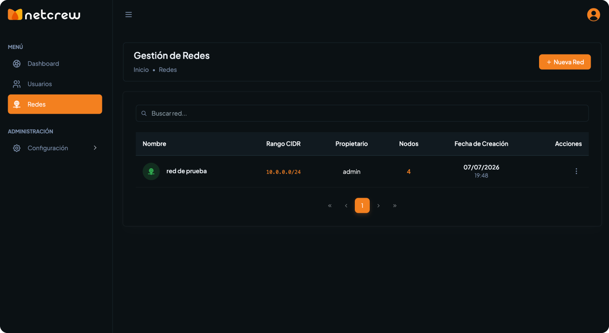
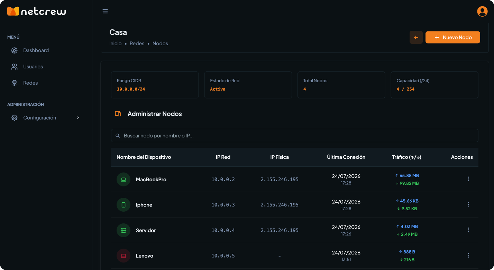
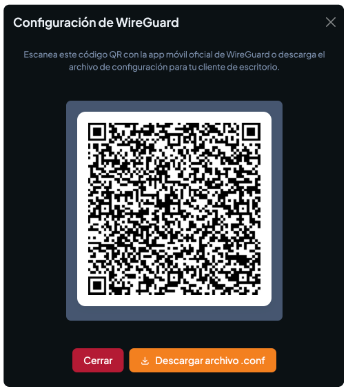
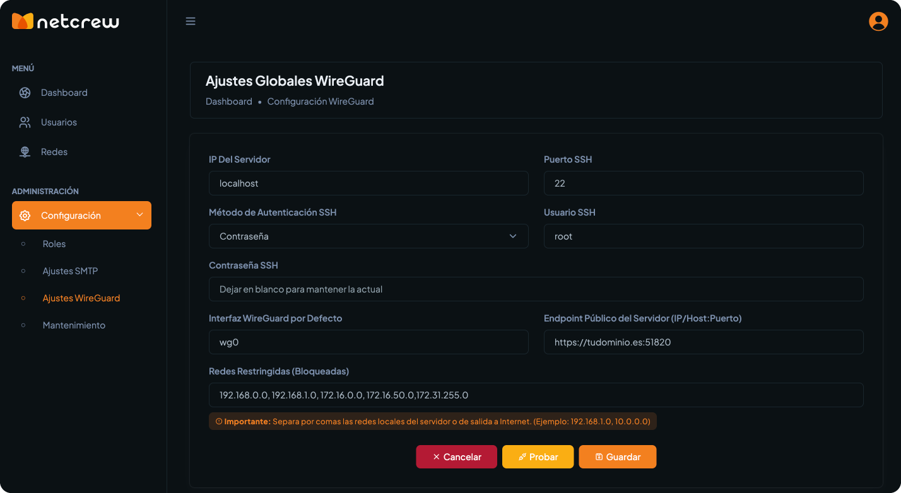
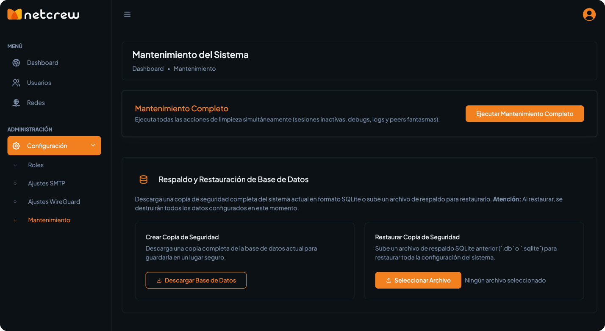
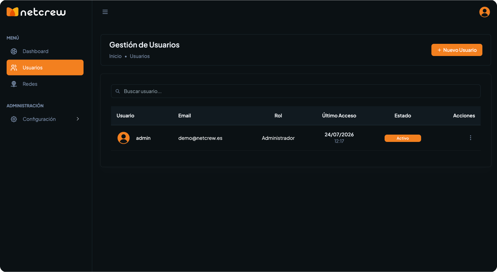
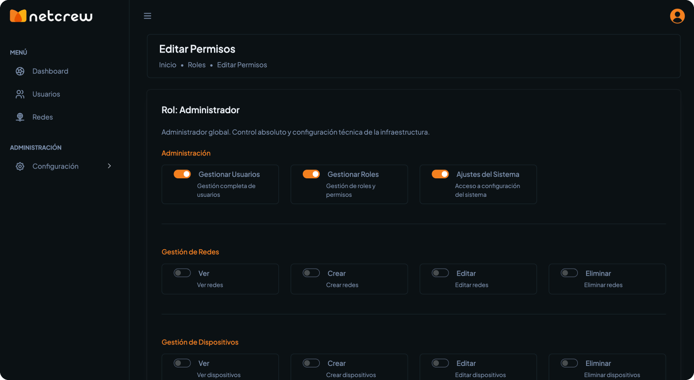

# 🚀 NetCrew - Centralized Nebula P2P Mesh VPN Manager

<p align="center">
  
  <br>
  <b>Plataforma Open Source de Administración Centralizada para Redes VPN Mesh P2P basadas en Nebula.</b>
  <br><br>
  <a href="https://github.com/fredeabal/netcrew/releases"></a>
  <a href="https://www.php.net/"></a>
  <a href="https://codeigniter.com/"></a>
  <a href="https://github.com/slackhq/nebula"></a>
  <a href="LICENSE"></a>
</p>

---

## 🚀 Instalación en 1 Paso

En cualquier servidor **Debian 11/12** o **Ubuntu 20.04 / 22.04 / 24.04** limpio con acceso root (VPS, máquina virtual o contenedor LXC), ejecuta el siguiente comando en tu terminal:

```bash
bash <(curl -s https://raw.githubusercontent.com/fredeabal/netcrew/main/install.sh)
```

El script se encargará automáticamente de instalar las dependencias, configurar el servidor web y preparar Nebula.

### 🔑 Credenciales por Defecto tras la Instalación
* **URL:** `http://TU_IP_O_DOMINIO`
* **Email:** `admin@demo.com`
* **Password:** `admin1234`

### ⚙️ Configuración Post-Instalación Recomendada

Para el correcto funcionamiento de todas las características de NetCrew, configura estos dos apartados en el panel de administración:

#### 1. 🔑 Ajustes Globales Nebula (Lighthouse P2P) y Acceso SSH
NetCrew gestiona el Lighthouse Nebula (localmente o mediante SSH en un servidor remoto) para aplicar cambios y leer telemetría en tiempo real:
* **Mismo Servidor (Despliegue Local):** Si ejecutas NetCrew en el mismo servidor donde corre el Lighthouse Nebula, indica el **Host/IP pública o dominio del Lighthouse** y el **Puerto UDP** (por defecto `4242`).
* **Servidor Remoto:** Si el Lighthouse se encuentra en otra máquina:
  1. Dirígete a **Ajustes Nebula** en la barra lateral del panel.
  2. Configura el endpoint público del Lighthouse, el cifrado (`aes` o `chacha20`) y si deseas habilitar el modo **Relay**.
  3. Introduce los datos de acceso SSH de la máquina remota (**Host SSH**, **Puerto**, **Usuario** con permisos de administración y su **Clave Privada** o contraseña).

#### 2. 📧 Configuración de Correo (SMTP)
NetCrew utiliza el servicio de correo para la recuperación de contraseñas, envío de configuraciones a clientes y notificaciones del sistema:
1. Ve a **Ajustes SMTP** en la barra lateral.
2. Introduce los datos de tu servidor de correo (Host, Puerto, Usuario, Contraseña y tipo de encriptación TLS/SSL).
3. Utiliza la opción **Enviar Correo de Prueba** para verificar que la configuración sea correcta.

---

## 🔄 Actualizar a la última versión

Para actualizar un servidor NetCrew existente a la última versión disponible (sin perder tus configuraciones, redes o bases de datos), ejecuta:

```bash
bash <(curl -s https://raw.githubusercontent.com/fredeabal/netcrew/main/update.sh)
```

---

## 💡 ¿Qué es NetCrew?

**NetCrew** es un **Control Plane** autohospedado para redes VPN **Nebula P2P Mesh**. Permite crear Autoridades Certificadoras (CA) independientes por red, emitir y revocar certificados de nodos, desplegar clientes con instaladores automáticos multiplataforma, supervisar el estado en tiempo real desde el Lighthouse y proteger los accesos mediante roles y permisos (RBAC).

Los nodos se descubren a través del **Lighthouse** y establecen túneles **P2P directos** con *NAT hole punching* (`punchy`), utilizando el **Relay** del Lighthouse automáticamente cuando algún extremo está detrás de un NAT estricto.

---

## ✨ Características Principales

### 🌐 Gestión de Redes, PKI y Nodos
* **Arquitectura P2P Mesh + Lighthouse:** Tráfico directo entre nodos con descubrimiento centralizado y soporte de *Relay* integrado.
* **PKI Propia por Red:** Generación automática de CA (`nebula-cert`), emisión de certificados firmados por nodo con grupos y revocación inmediata mediante `pki.blocklist`.
* **Instaladores Automáticos Multiplataforma:**
  * **Windows / Windows Server (`.bat` y `.ps1`):** Descarga `nebula.exe` + `wintun.dll`, configura `tun.dev: Nebula`, registra el servicio de Windows con recuperación automática ante fallos (`sc failure`) y añade la regla de firewall ICMPv4.
  * **macOS (`.zip` / `.command` y `.sh`):** Instala Nebula vía Homebrew y gestiona el servicio con `brew services`.
  * **Linux (`.sh`):** Descarga el binario oficial (`amd64`/`arm64`) y configura el servicio `systemd` (`nebula.service`).
  * **iOS / Android / Manual (`.yml`):** Archivo YAML estándar listo para importar en la app oficial de Nebula.
* **Accesos Temporales con Expiración:** Asignación de fecha de caducidad por dispositivo con revocación/desactivación automática.
* **Rotación de Certificados en 1 Clic:** Regeneración instantánea de llaves y certificado conservando la misma IP VPN asignada.
* **Compartición Ágil y Segura:** Envío por correo electrónico y enlaces temporales autodestruibles (One-Time Link) para descargar o instalar clientes sin login.
* **Asignación IP Inteligente:** Cálculo y prevención de colisiones dentro del rango CIDR asignado a cada red.

### 🔸 Gestión de Redes
Crea y administra múltiples redes VPN virtuales asignando rangos CIDR únicos, subredes y sus respectivas Autoridades Certificadoras (CA).
<p align="center">
  
</p>

### 🔸 Gestión de Nodos
Añade, edita y supervisa el estado en vivo de los nodos conectados a cada red, controlando sus IPs VPN, certificados y grupos.
<p align="center">
  
</p>

### 🔸 Despliegue e Importación al Cliente
Descarga instaladores autoejecutables para Windows, macOS y Linux o el archivo `.yml` para móviles y clientes manuales.
<p align="center">
  
</p>

### ⚡ Telemetría & Mantenimiento en Tiempo Real
* **Estado Online en Vivo:** Lectura de handshakes del Lighthouse (`journalctl -u nebula`) local o vía SSH (`phpseclib3`), combinada con sondeo ICMP desde `nebula1` y soporte para entornos LXC sin `/dev/net/tun` (modo Lighthouse puro).
* **Diagnóstico Integrado (Ping ICMP):** Verificación de conectividad en tiempo real hacia cualquier nodo directamente desde la interfaz.
* **Mantenimiento y Respaldo en 1 Clic:** Limpieza integrada de sesiones/logs/caché, optimización SQLite (`VACUUM`), y descarga/restauración de copias de seguridad de la base de datos.

### 🔸 Ajustes Nebula (Lighthouse P2P)
Configura el endpoint público del Lighthouse, puerto UDP, cifrado (`aes` / `chacha20`), modo Relay y credenciales de sincronización SSH.
<p align="center">
  
</p>

### 🔸 Mantenimiento del Sistema
Herramientas integradas para realizar optimizaciones de base de datos, depuración de logs de sistema y control de servicios en 1 clic.
<p align="center">
  
</p>

### 🛡️ Seguridad Avanzada y Roles (RBAC)
* **Gestión de Permisos Modular:** Integración nativa con **CodeIgniter Shield** para definir roles granulares (`superadmin`, `supervisor`, `user`).
* **Registro de Auditoría (Audit Logs):** Trazabilidad completa con visor dedicado para registrar eventos de creación/eliminación de nodos, descargas, cambios de permisos y accesos con IP y User-Agent.
* **Control Jerárquico y Anti-IDOR:** Control estricto de propiedad sobre redes y dispositivos para evitar accesos cruzados no autorizados.
* **Encriptación de Extremo a Extremo:** Almacenamiento cifrado en reposo para llaves privadas de CA/nodos y credenciales SSH/SMTP.
* **Protección Integral:** Content Security Policy (CSP) con nonces, filtros CSRF por sesión, sanitización estricta de dominios/YAML y validación de rangos CIDR privados RFC 1918.

### 📱 Experiencia de Usuario Responsiva (Mobile-First)
* **Vistas Adaptativas:** Listados con soporte de tarjetas móviles dedicadas y tablas optimizadas para escritorio.
* **Diseño Moderno:** Login interactivo, tema claro/oscuro persistente y soporte para Select2 con búsqueda.

### 🔸 Gestión de Usuarios
Administra las cuentas con acceso a la plataforma, asignando datos de perfil, estados y roles de usuario.
<p align="center">
  
</p>

### 🔸 Gestión de Permisos (RBAC)
Control de acceso granular basado en roles para definir y restringir permisos específicos por módulo a cada perfil.
<p align="center">
  
</p>

---

## 🛠️ Stack Tecnológico

| Componente | Tecnología |
| :--- | :--- |
| **Backend Core** | CodeIgniter 4.x (PHP 8.2+) |
| **Autenticación** | CodeIgniter Shield |
| **Base de Datos** | SQLite3 (con modo WAL) |
| **Protocolo VPN** | Nebula P2P Mesh (`nebula` / `nebula-cert`) |
| **SSH Client** | `phpseclib3` |
| **Frontend** | Bootstrap 5, ApexCharts, SweetAlert2, Tabler Icons, Select2 |

---

## 🔒 Exención de Responsabilidad

- **Privacidad Local:** NetCrew no recopila ni transmite información a servidores externos. Toda la configuración se almacena localmente en tu propio servidor.
- **Responsabilidad:** El usuario es el único responsable de la seguridad de su infraestructura y de realizar copias de seguridad de sus archivos de datos y llaves SSH.
- **Licencia:** Distribuido "tal cual" (As Is) bajo la licencia MIT.

  <br>

---

<p align="center">
  <a href="https://donate.stripe.com/5kQ7sEdPB0IY3g49aCgnK00">
    
  </a>
</p>
